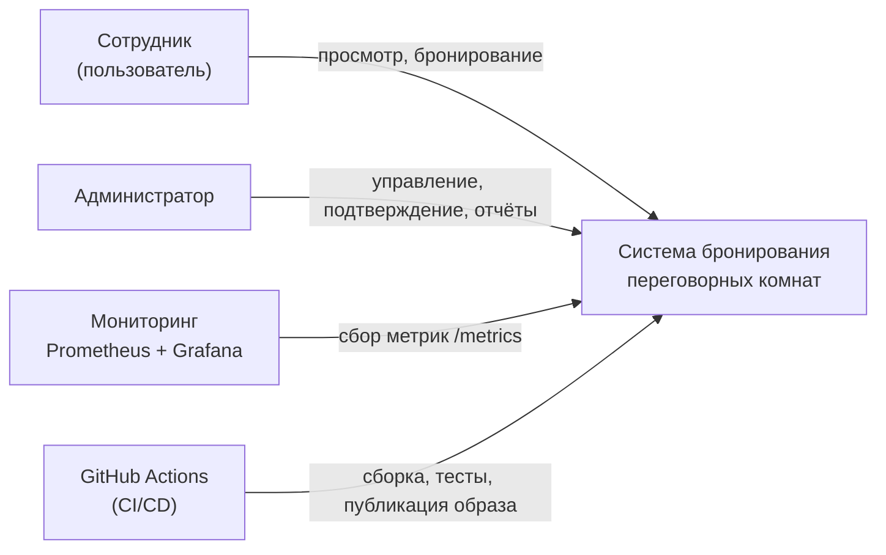
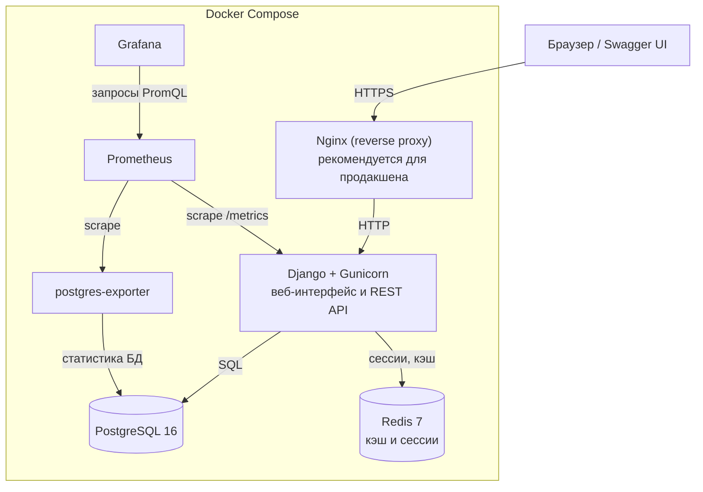
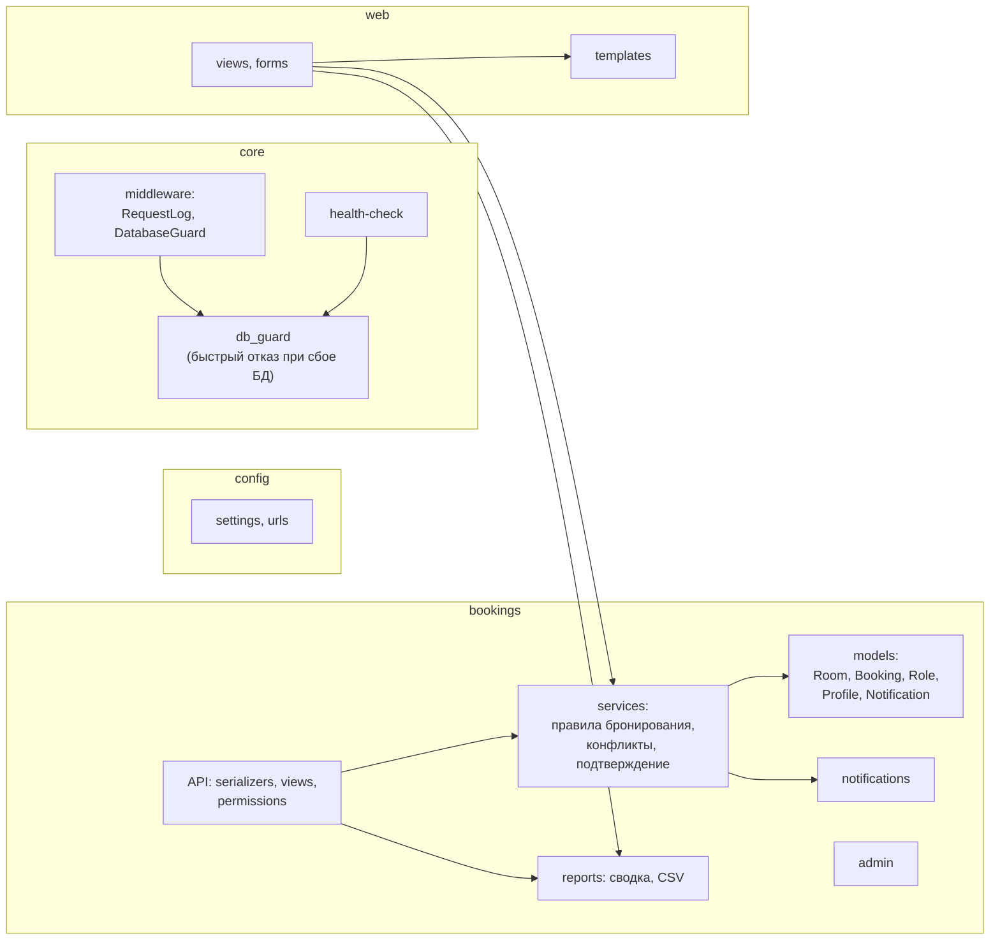
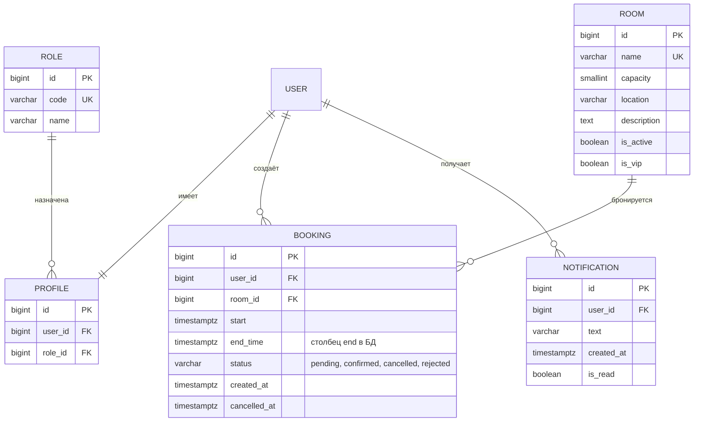
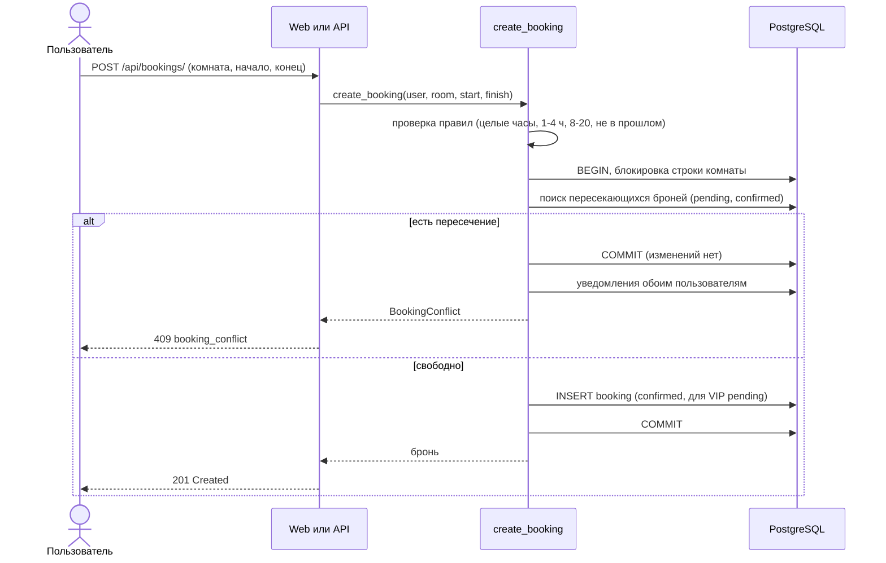
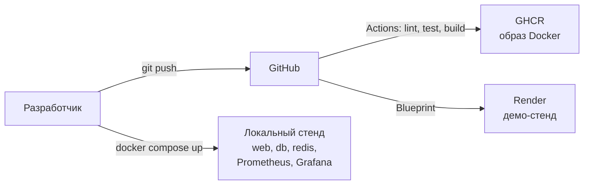

# Архитектура

Схемы написаны на Mermaid и отображаются на GitHub.

## 1. Контекст системы (C4, уровень 1)

## 2. Контейнеры (C4, уровень 2)

В демо-стенде браузер обращается к Gunicorn напрямую (порт 8000), Nginx не используется.

## 3. Компоненты приложения (C4, уровень 3)

Бизнес-правила находятся в `bookings/services.py` и используются и веб-интерфейсом, и API. Это исключает расхождение логики.

## 4. Модель данных

Ограничение БД: время окончания строго позже начала. Индекс по комнате и интервалу ускоряет поиск пересечений. Пользователь (`USER`) это стандартная модель Django.

## 5. Поток данных: бронирование и конфликт

Блокировка строки комнаты (`SELECT ... FOR UPDATE`) выстраивает параллельные запросы на одну комнату по очереди, поэтому двойное бронирование невозможно.

## 6. Схема развёртывания

## 7. Внешние интеграции

В MVP внешних бизнес-интеграций нет. Технические: GitHub (код, CI, образы), Prometheus/Grafana (мониторинг), хостинг демо-стенда (Render).
